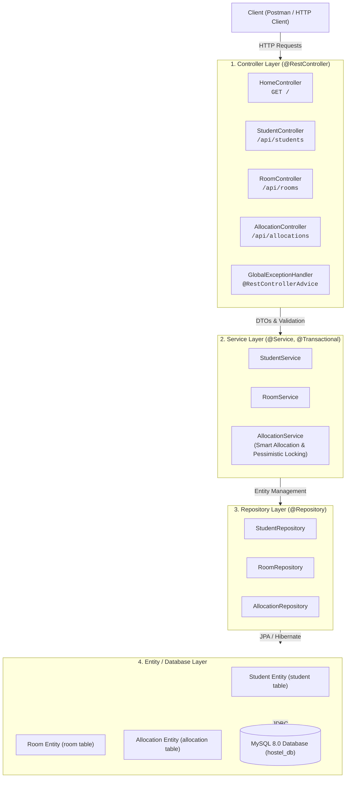
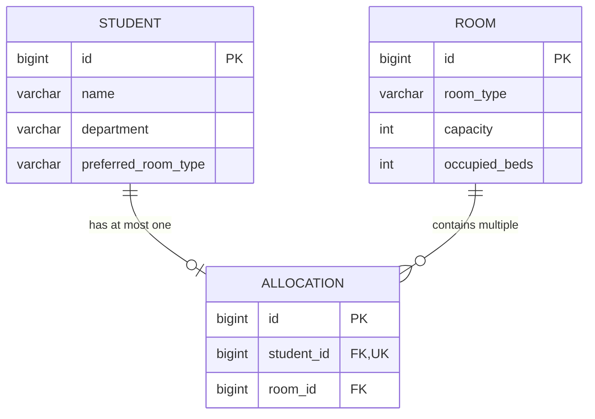

# Smart Hostel Room Allocation System

A robust, enterprise-grade Spring Boot backend service designed to streamline university hostel operations. The system automates student registration, room capacity management, intelligent preference-based bed allocation, and seamless room vacating with strict transactional consistency and concurrency controls.

---

## 1. Project Overview

Manual hostel room allocation in universities is notoriously error-prone, labor-intensive, and susceptible to double allocations, capacity violations, and student preference mismatches. 

The **Smart Hostel Room Allocation System** solves this problem by providing a centralized RESTful backend that:
- Automatically pairs students with rooms matching their preferred room type.
- Optimizes room utilization by prioritizing rooms with the highest free capacity.
- Enforces strict invariants: no room can exceed its capacity, no student can possess multiple active allocations, and occupancy counts always stay in sync with active allocation records.
- Guarantees thread-safe concurrency using database-level constraints and JPA pessimistic locking.

---

## 2. Implemented Features

- **Student Management**: Register students with departmental information and preferred room types (`Single`, `Double`, etc.) with comprehensive input validation.
- **Hostel Room Management**: Configure hostel rooms with defined capacities; ensures newly created rooms default to zero occupancy and prevents negative bed counts.
- **Smart Room Allocation Algorithm**:
  - Filters eligible rooms by student preference (case-insensitive & trimmed).
  - Sorts candidate rooms by highest available capacity first (tie-breaking by lowest room ID).
  - Acquires a database-level pessimistic lock (`SELECT ... FOR UPDATE`) and refreshes room capacity to eliminate race conditions.
  - Automatically updates room occupancy and creates an active allocation record within a single atomic transaction.
- **Duplicate Allocation Prevention**: Enforced via service-level conflict checks and database-level unique constraints on `student_id`.
- **Room Vacating & Bed Reclamation**: Allows students to vacate allocated rooms, immediately decrementing occupied bed counts and releasing the bed for subsequent students.
- **Transactional Consistency & Concurrency Protection**: Atomic rollback ensures database integrity if an allocation fails.
- **Global Error Handling**: Standardized, clean JSON error responses for `400 Bad Request`, `404 Not Found`, `409 Conflict`, and `500 Internal Server Error` without leaking stack traces or credentials.
- **MySQL & In-Memory H2 Dual Persistence**: MySQL 8.0 for production/local runtime persistence; isolated in-memory H2 database for zero-impact, hermetic automated test suites.

---

## 3. Technology Stack

| Technology | Version | Role in Project |
|---|---|---|
| **Java** | 21 (LTS) | Core programming language leveraging modern syntax and language features |
| **Spring Boot** | 4.1.1 | Application framework providing dependency injection, embedded Tomcat, and autoconfiguration |
| **Spring Web (MVC)** | 7.0.9 | REST API controllers, content negotiation, and HTTP request dispatching |
| **Spring Data JPA** | 4.1.1 | Repository abstraction layer for object-relational mapping and data queries |
| **Hibernate ORM** | 7.4.5 | JPA implementation managing entities, SQL generation, schema evolution, and locking |
| **MySQL Connector/J** | 9.7.0 | High-performance JDBC driver for MySQL 8.0 database connectivity |
| **MySQL Server** | 8.0+ | Production relational database engine storing students, rooms, and allocations |
| **H2 Database** | 2.4.240 | Fast, isolated in-memory test database for non-destructive automated test runs |
| **Maven Wrapper** | 3.5.0+ | Build automation tool orchestrating compilation, dependencies, and testing |
| **JUnit 5 & MockMvc** | Latest | Automated testing framework for unit, integration, and multi-threaded concurrency suites |

---

## 4. Architectural Design

The application adheres to a clean **4-Layer Architecture**:



### Layer Responsibilities
1. **Controller Layer**: Handles incoming HTTP requests, validates request payloads via `@Valid`, delegates processing to services, and returns standardized HTTP status codes (`200`, `201`, `400`, `404`, `409`).
2. **Service Layer**: Houses core business logic, input sanitization, sorting algorithms, room selection criteria, pessimistic locking, and transaction boundaries (`@Transactional`).
3. **Repository Layer**: Extends Spring Data JPA `JpaRepository` interfaces, exposing type-safe CRUD operations and custom query methods.
4. **Entity Layer**: Defines the JPA entities, column mappings, unique keys, and relational foreign-key associations.

---

## 5. Database Design & Relationships



### Entities & Invariants
1. **`Student` (`student`)**:
   - `id` (BIGINT, Primary Key, Auto-Increment)
   - `name` (VARCHAR, Not Null, Validated Not Blank)
   - `department` (VARCHAR, Not Null, Validated Not Blank)
   - `preferred_room_type` (VARCHAR, Not Null, e.g., "Single", "Double")
2. **`Room` (`room`)**:
   - `id` (BIGINT, Primary Key, Auto-Increment)
   - `room_type` (VARCHAR, Not Null, e.g., "Single", "Double", "Deluxe AC")
   - `capacity` (INT, Not Null, Min 1)
   - `occupied_beds` (INT, Not Null, Min 0, defaults to 0)
3. **`Allocation` (`allocation`)**:
   - `id` (BIGINT, Primary Key, Auto-Increment)
   - `student_id` (BIGINT, Foreign Key referencing `student.id`, **UNIQUE KEY** ensuring at most 1 active room allocation per student)
   - `room_id` (BIGINT, Foreign Key referencing `room.id`)

---

## 6. Setup & Installation

### Prerequisites
1. **Java Development Kit (JDK 21 LTS)** installed and configured.
   Verify with:
   ```powershell
   java -version
   ```
2. **MySQL Server 8.0+** running as a service (e.g. `MySQL80`).
3. **Database Setup**:
   Log into MySQL and verify or create the database:
   ```sql
   CREATE DATABASE IF NOT EXISTS hostel_db;
   ```

### Database Credentials Configuration
In `src/main/resources/application.properties`, the application is configured to read the database password securely from the environment variable `DB_PASSWORD`:

```properties
spring.application.name=hostel-allocation

spring.datasource.url=jdbc:mysql://localhost:3306/hostel_db
spring.datasource.username=root
spring.datasource.password=${DB_PASSWORD}

spring.jpa.hibernate.ddl-auto=update
spring.jpa.show-sql=true
spring.jpa.open-in-view=false

server.port=8080
```

Set the environment variable in your terminal (replace `your_password` with your MySQL root password):
```powershell
$env:DB_PASSWORD="your_password"
```

---

## 7. Build, Test, and Run Instructions

### Step 1: Run Automated Tests
Execute the comprehensive test suite (29 tests including concurrency and edge case validations running on an isolated in-memory test database):
```powershell
.\mvnw.cmd clean test
```

### Step 2: Start the Application
Boot up the Spring Boot server connected to MySQL `hostel_db`:
```powershell
.\mvnw.cmd spring-boot:run
```

Once started, the server will be available at:
`http://localhost:8080/`

---

## 8. REST API Documentation

**Base URL**: `http://localhost:8080/api`

### 1. Student Management Endpoints

#### Register Student
- **Method**: `POST`
- **URL**: `http://localhost:8080/api/students`
- **Request Body**:
  ```json
  {
      "name": "Ananya Sharma",
      "department": "Computer Science",
      "preferredRoomType": "Double"
  }
  ```
- **Response**: `201 Created`
  ```json
  {
      "id": 1,
      "name": "Ananya Sharma",
      "department": "Computer Science",
      "preferredRoomType": "Double"
  }
  ```

#### Retrieve All Students
- **Method**: `GET`
- **URL**: `http://localhost:8080/api/students`
- **Response**: `200 OK`
  ```json
  [
      {
          "id": 1,
          "name": "Ananya Sharma",
          "department": "Computer Science",
          "preferredRoomType": "Double"
      }
  ]
  ```

#### Retrieve Student by ID
- **Method**: `GET`
- **URL**: `http://localhost:8080/api/students/{id}`
- **Response**: `200 OK` (or `404 Not Found`)

---

### 2. Room Management Endpoints

#### Add Hostel Room
- **Method**: `POST`
- **URL**: `http://localhost:8080/api/rooms`
- **Request Body**:
  ```json
  {
      "roomType": "Double",
      "capacity": 2
  }
  ```
- **Response**: `201 Created`
  ```json
  {
      "id": 1,
      "roomType": "Double",
      "capacity": 2,
      "occupiedBeds": 0
  }
  ```

#### Retrieve All Rooms
- **Method**: `GET`
- **URL**: `http://localhost:8080/api/rooms`
- **Response**: `200 OK`

#### Retrieve Room by ID
- **Method**: `GET`
- **URL**: `http://localhost:8080/api/rooms/{id}`
- **Response**: `200 OK` (or `404 Not Found`)

---

### 3. Room Allocation Endpoints

#### Smart Room Allocation
- **Method**: `POST`
- **URL**: `http://localhost:8080/api/allocations/{studentId}`
- **Response**: `201 Created`
  ```json
  {
      "allocationId": 1,
      "studentId": 1,
      "studentName": "Ananya Sharma",
      "department": "Computer Science",
      "roomId": 1,
      "roomType": "Double",
      "occupiedBeds": 1,
      "capacity": 2
  }
  ```
- **Error Responses**:
  - `404 Not Found`: Student does not exist.
  - `409 Conflict`: Student already has an active allocation, or no eligible room matching the preference has available beds.

#### Retrieve All Active Allocations
- **Method**: `GET`
- **URL**: `http://localhost:8080/api/allocations`
- **Response**: `200 OK`

#### Vacate Room
- **Method**: `DELETE`
- **URL**: `http://localhost:8080/api/allocations/{studentId}`
- **Response**: `200 OK`
  ```json
  {
      "message": "Room vacated successfully",
      "studentId": 1,
      "studentName": "Ananya Sharma",
      "roomId": 1,
      "updatedOccupiedBeds": 0
  }
  ```
- **Error Responses**:
  - `404 Not Found`: Student does not exist or has no active room allocation.

---

## 9. Error Handling & HTTP Status Codes

The application uses `@RestControllerAdvice` in `GlobalExceptionHandler` to produce consistent JSON error payloads:

```json
{
    "timestamp": "2026-10-21T10:30:00",
    "status": 409,
    "error": "Conflict",
    "message": "Student already has an active room allocation.",
    "path": "/api/allocations/1"
}
```

| HTTP Status | Condition | Example Scenario |
|---|---|---|
| `200 OK` | Successful retrieval or deletion operation | `GET /api/students`, `DELETE /api/allocations/1` |
| `201 Created` | Successful entity or allocation creation | `POST /api/students`, `POST /api/allocations/1` |
| `400 Bad Request` | Validation constraint violation / Malformed request | Blank student name, zero capacity, missing body |
| `404 Not Found` | Requested entity does not exist | Student ID 99999 does not exist |
| `409 Conflict` | Duplicate allocation or unavailable room capacity | Student already allocated; room is full |
| `500 Internal Error` | Unexpected server failure | Database server unreachable (sanitized message) |

---

## 10. Automated Testing & Postman Collection

### Automated Tests Overview
The automated test suite in `src/test/java/com/example/hostel` includes 29 assertions across 4 test classes:
- **`StudentIntegrationTest`**: Validates registration, retrieval, empty request bodies, blank fields, and 404 lookups.
- **`RoomIntegrationTest`**: Validates room creation, capacity > 0 enforcement, occupied beds initialization, negative input rejection.
- **`AllocationIntegrationTest`**: Validates preference matching, capacity decrement/increment, duplicate allocation prevention, unavailable room rejection, and bed reuse after vacating.
- **`ConcurrencyAllocationTest`**: Executes 5 concurrent threads competing for a single available bed; proves pessimistic write locking eliminates race conditions and ensures zero capacity over-allocation.

### Importing and Running the Postman Collection
1. Launch Postman.
2. Click **Import** (top left) and select:
   `Smart_Hostel_Allocation_API.postman_collection.json`
3. Verify the collection variable `baseUrl` is set to `http://localhost:8080/api`.
4. Run requests in folder order:
   1. `1. Student Management`
   2. `2. Room Management`
   3. `3. Room Allocation`
   4. `4. Vacating Rooms`
   5. `5. Error Handling`
   Each request contains automated test scripts that capture IDs and assert status codes.
